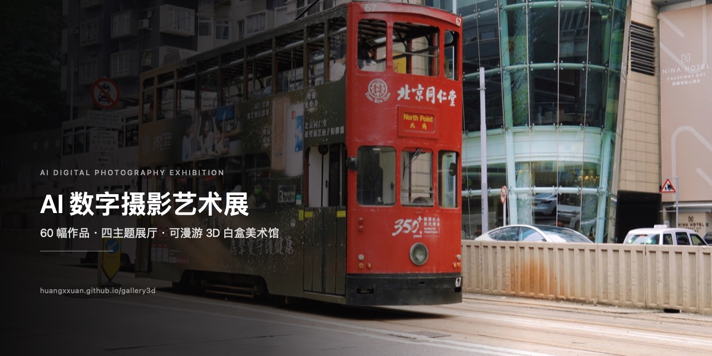

# AI Digital Photography Exhibition · 60 Works

**English** · [简体中文](README.md)

[](https://github.com/Huangxxuan/gallery3d/actions/workflows/deploy.yml)
[](LICENSE)



## Live demo

**https://huangxxuan.github.io/gallery3d/**

Open in a desktop browser — no install, no sign-in. WebGL and a keyboard are required for the best experience.

## What this is

A first-person walkable **3D online photography gallery**. Four themed halls, 60 photographs hung with real exhibition logic.

| Hall | Theme | Works |
|---|---|---|
| H1 | Hong Kong Stories | 15 |
| H2 | Twin Cities | 15 |
| H3 | Sea & Harbour | 15 |
| H4 | Forest Creatures | 15 |

The architecture uses a "white box" language: white walls, light grey floors, a shared ceiling frame, dark steel arch rings and projected light pools. The entrance and exit halls use a silver-white treatment. Each work is mounted in a champagne titanium frame with a white mat; click a work to open the high-resolution view.

## Controls

Click "Enter" on the start screen (or press Enter) to begin walking.

| Action | Input |
|---|---|
| Walk | `W` `A` `S` `D` or arrow keys |
| Run | hold `Shift` |
| Look around | hold left mouse button and drag; mouse movement fine-tunes |
| Open a work | click the artwork on the wall |
| Next / previous work (in detail view) | `←` `→` (or `A` `D`) |
| Exit detail view | `Esc` / `Backspace` |
| Autopilot tour | `P` toggles |
| Back to entrance | `R` |

QA helpers: `?cam=x,z,yaw,pitch` jumps to a camera pose, `?artview=0` opens the debug inspection view used for screenshot reviews.

## Tech stack

- **Rendering**: three.js 0.186 + React Three Fiber 9 + @react-three/drei
- **App**: React 19 + TypeScript 7, built with Vite 8
- **State**: zustand 5 (mode machine / focused work / current hall)
- **Tests**: Vitest 5 (placement rules, zoning, light-pool geometry, camera snapshots)
- **Deployment**: GitHub Actions → GitHub Pages (auto-publish on push to `main`)

## Project structure

```
src/
  domain/       Hall geometry, placement rules, theme config (pure data & functions)
  three/        Scene: walls, arches, ceilings, artworks, texture tiers, capsule collision, camera
  state/        zustand store: walk/detail mode, focused work, zone detection
  ui/           HUD overlay: start screen, control hints, detail-view bar
  spike/        Light-pool / zoning / camera experiments (research only, not shipped)
public/
  manifest.json Work list (id / three image tiers / theme / hall / dimensions)
  photos/       Primary tier (long edge 1300); lo/ distant halls; hd/ full-size
scripts/
  prepare-assets.mjs  Asset pipeline: source images → three JPEG tiers + manifest v2
docs/         Design decisions, ADRs and handoff docs
```

## Run locally

Node 18+ required (CI uses Node 22).

```bash
export PATH="$HOME/.local/node/bin:$PATH"   # adjust to your Node install path
npm install
npm run dev        # http://localhost:5173/
npm test           # Vitest unit tests
npm run build      # outputs dist/
npm run preview    # preview the production build
```

## Build & deploy

`.github/workflows/deploy.yml` runs on every push to `main`: `npm ci` → `npm run build` → upload `dist/` → publish to GitHub Pages.

`vite.config.ts` sets `base: './'`, so the same build works at the site root (local / offline bundle) and under the `/gallery3d/` Pages sub-path.

## Asset pipeline

```bash
node scripts/prepare-assets.mjs
```

Reads source photos from `~/Downloads/摄影作品/<category>/*.{jpg,jpeg,png,heic}`, produces three JPEG tiers with macOS `sips` (primary long edge 2048, distant halls 1024, full-size 4096 — the shipped build is further compressed to 1300 / 800 / 1600 to keep the repository small), and writes `public/manifest.json`.

## License

- **Code**: Apache License 2.0 — see [LICENSE](LICENSE).
- **Photographs and exhibition imagery** (`public/photos/**`, `docs/social-preview.jpg`): all rights reserved by the author. These are **not** covered by Apache-2.0 and may not be copied, reused commercially, or redistributed without permission.

If you reuse the code, keep the LICENSE and copyright notice. For image usage, contact the author first.
