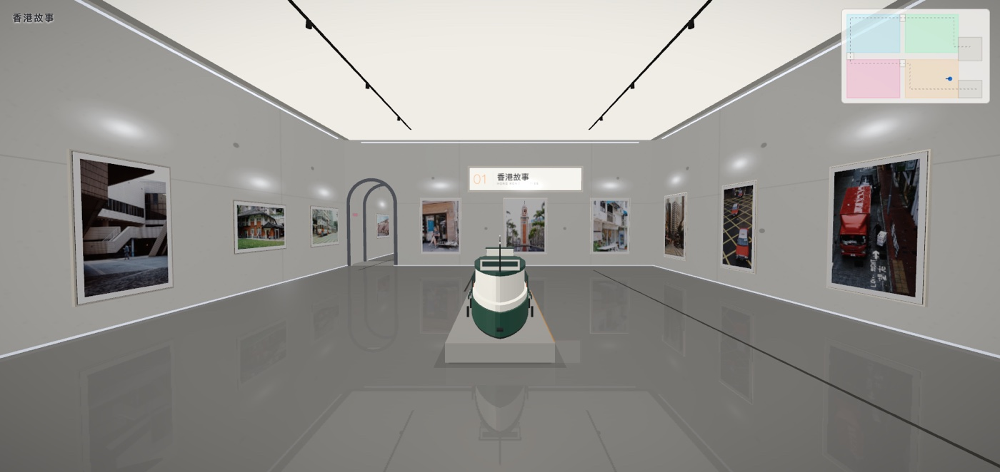
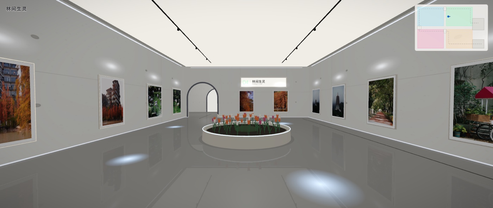
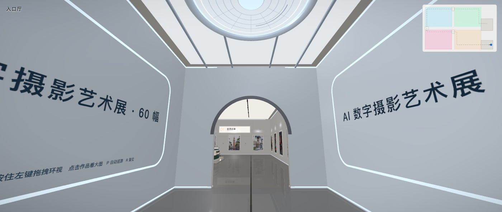

# 3D Exhibition Builder

**English** · [简体中文](README.md)

[](https://github.com/Huangxxuan/gallery3d/actions/workflows/deploy.yml)
[](LICENSE)



**Turn a folder of images into a gallery you can walk through.**

Not a video, not a 360° panorama, not a template-driven landing page. It renders a full-scale building in the browser in real time: walls, door openings, arches, ceiling light coves, spotlight pools, reflective floors, and mounted frames are all generated from code. Visitors walk in with a keyboard, stand in front of a work, click once for the large view.

Out of the box it ships a 60-work photography exhibition as a demo. Swap the images and the titles, and it becomes yours.

**Live demo** — <https://huangxxuan.github.io/gallery3d/> (desktop Chrome / Safari / Edge; requires WebGL and a keyboard)

---

## 1. What you can build

| Use case | How it maps |
|---|---|
| **Solo or group photo show** | Split by theme, one hall one colour temperature, works are hung automatically |
| **Art exhibition** | Portrait, landscape, and square formats mixed; aspect ratio preserved, never cropped or stretched |
| **Relics / collection display** | Fixed camera positions plus per-item large view for detail inspection |
| **Graduation show / team portfolio** | One repo, one show; replace the images to replace the show |
| **Online venue for a venue, store, or institution** | Pure static site; host on GitHub Pages or any CDN |



---

## 2. How it works, in 30 seconds

```
your image folders
      │  scripts/prepare-assets.mjs (three size tiers + real pixel dimensions)
      ▼
public/manifest.json  ← exhibit list: what hangs, in which hall, which orientation
      │  src/three/placements.ts (automatic hanging algorithm)
      ▼
wall slots  ← fixed pitch, centred, edge margins, zero cropping
      │  React Three Fiber real-time rendering
      ▼
a 3D gallery in the browser
```

**Hanging is computed, not hand-placed.** You supply "which images, which hall", and the rest is derived:

- Centre-to-centre pitch is a constant **3.5 m**; leftover wall length becomes edge margin (margin is what reads as curation)
- Slots stay at least **1.45 m** from corners and door edges, so frames never overlap an opening
- Portraits are normalised to 2.1 m height, landscapes to 1.9 m width; extreme ratios shrink into a 2.4 × 2.3 m box — **never cropped, never stretched**
- Each hall selects **15** works by default (`SELECT_CAP`); extras are sampled evenly across categories
- The large-view camera distance adapts to artwork height (1.35–2.6 m), and clicking flies you to the artwork centre



---

## 3. Make it your own exhibition

Four edits, from required to optional. **Steps 1 and 2 alone are enough to run a new show.**

### Step 1 — Organise your images (required)

Group images into category folders; folders map to halls.

```
my-photos/
├── city/
│   ├── a.jpg
│   └── b.jpg
└── coast/
    └── c.jpg
```

`jpg / jpeg / png / heic` are supported. Conversion uses the macOS system `sips` tool — no third-party image library required.

### Step 2 — Edit the hall mapping (required)

Open [`scripts/prepare-assets.mjs`](scripts/prepare-assets.mjs) and edit `HALL_GROUPS`:

```js
const HALL_GROUPS = [
  { hall: 'H1', theme: 'My Hall One', cats: ['city'] },
  { hall: 'H2', theme: 'My Hall Two', cats: ['coast'] },
  { hall: 'H3', theme: 'My Hall Three', cats: ['portrait', 'street'] },  // one hall, several folders
  { hall: 'H4', theme: 'My Hall Four', cats: ['still-life'] },
]
```

Then run:

```bash
PHOTO_SRC=/path/to/my-photos node scripts/prepare-assets.mjs
```

(Without `PHOTO_SRC` the script reads `~/Downloads/摄影作品`.)

This produces three JPEG tiers and a fresh `public/manifest.json`: main tier 2048 px on the long edge, distant tier 1024, large view 4096.

### Step 3 — Edit hall names and accent colours (strongly recommended)

Open [`src/domain/themes.ts`](src/domain/themes.ts) — one line per hall:

```ts
export const THEMES: Record<string, HallTheme> = {
  H1: { name: 'My Hall One', en: 'MY HALL ONE', accent: '#ffb054', glow: '#ffcf8a' },
  ...
}
```

`accent` drives the wall plaque and UI colour, `glow` drives the light-cove bloom. After the change, the new names appear on the wall plaques, the top-left label, and the entrance wall text.

### Step 4 — Edit the exhibition title (optional)

The exhibition title currently lives in three places; replace all of them:

| File | Where |
|---|---|
| [`src/ui/HUD.tsx`](src/ui/HUD.tsx) | Intro screen headline and subtitle |
| [`src/three/GalleryWorld.tsx`](src/three/GalleryWorld.tsx) | Entrance-hall illuminated wall text (two spots) |
| [`index.html`](index.html) | Browser title and `og:*` share card |

Then:

```bash
export PATH="$HOME/.local/node/bin:$PATH"
npm install
npm run dev        # http://localhost:5173/
```

### Change reference

| What you want to change | Where | Re-run asset pipeline |
|---|---|---|
| Images | folder contents + `HALL_GROUPS` | Yes |
| Hall names / accent colours | `src/domain/themes.ts` | No |
| Exhibition title | the three places above | No |
| Share card | `docs/social-preview.jpg` + `public/social-preview.jpg` (1280×640) | No |
| Works per hall | `SELECT_CAP` (`src/three/placements.ts`) | No |
| Hall count and building dimensions | `SPACES` in `src/domain/gallery.ts` | No |

---

## 4. Controls

The intro screen appears first; click the "点击进入" button to start.

| Action | Input |
|---|---|
| Walk forward / left / right / back | `W` `A` `S` `D` or arrow keys |
| Run | hold `Shift` |
| Look around | hold left mouse button and drag; pointer movement adds fine adjustment |
| Open a work | click a framed artwork |
| Next / previous work in large view | `←` `→` (or `A` `D`) |
| Exit large view | `Esc` / `Backspace` |
| Toggle auto-tour | `P` |
| Return to entrance | `R` |

Debug parameters (handy for screenshot QA): `?cam=x,z,yaw,pitch` places the camera, `?artview=n` stands in front of work n, `?focus=n` opens the large view of work n.

---

## 5. Tech stack

| Layer | Choice |
|---|---|
| Rendering | three.js 0.186 + React Three Fiber 9 + @react-three/drei |
| Framework | React 19 + TypeScript 7, built with Vite 8 |
| State | zustand 5 (mode machine / focused work / current hall) |
| Tests | Vitest 5 (hanging rules, zoning, spotlight geometry, camera snapshots) |
| Deployment | GitHub Actions → GitHub Pages, published on every push to `main` |

Everything is static front-end assets: no backend, no database, no external font CDN (wall text is generated at runtime with Canvas, so it works offline).

---

## 6. Project structure

```
src/
  domain/       hall geometry, slot algorithm, theme config (pure data + pure functions, unit-tested)
  three/        scene rendering: walls / arches / ceilings / artworks / texture tiers / collision / camera / wall text
  state/        zustand state machine
  ui/           HUD: intro screen, control hints, large-view footer
  spike/        spotlight and camera experiments (research only, not in the live path)
public/
  manifest.json exhibit list (id / three image tiers / hall / real dimensions)
  photos/       three tiers: main · lo/ for distant halls · hd/ for large view
scripts/
  prepare-assets.mjs  asset pipeline: source images → three JPEG tiers + manifest
  gen-floorplan.mjs   floor plan generation
docs/          design notes, ADRs, handoff docs, share card and screenshots
```

---

## 7. Run and deploy

```bash
export PATH="$HOME/.local/node/bin:$PATH"   # needed in non-interactive shells; adjust to your Node location
npm install
npm run dev        # dev server
npm test           # unit tests
npm run build      # produces dist/
npm run preview    # preview the build
```

After a push to `main`, `.github/workflows/deploy.yml` runs `npm ci` → `npm run build` and publishes to Pages.

[`vite.config.ts`](vite.config.ts) sets `base: './'`, so a single `dist/` works at the domain root (local preview, offline bundle, USB distribution) and under the Pages sub-path `/gallery3d/`.

---

## 8. Known boundaries

Stated plainly rather than hidden — these are deliberate trade-offs, not pending bugs:

- **Four halls, fixed.** The building is a complete 2×2 cluster with a serpentine route. Changing the hall count means editing `SPACES` geometry (which is covered by door-invariant tests); it is not a config value.
- **15 works per hall**, 60 in total. Raise `SELECT_CAP` if your wall length and content allow it.
- **No CMS.** The exhibit list is a JSON file versioned in git.
- **WebGL and a keyboard required.** It loads on mobile, but the walkthrough is designed for desktop.
- **Repository size grows linearly with the collection.** The demo's 148 images total about 115 MB against a 1 GB Pages limit; for large collections, host `public/photos/` on object storage or a CDN.

---

## 9. License

- **Code**: Apache License 2.0, see [LICENSE](LICENSE). Commercial use, modification, and closed-source distribution are permitted with attribution.
- **Demo photographs and screenshots** (`public/photos/**`, `docs/*.jpg`): all rights reserved by the author, **not** covered by Apache-2.0. Redistribution, commercial use, or republication requires permission.

To build your own show on this system: fork it, swap in your own images, and your work stays yours.

---

## 10. Documentation authority

- **Canonical entry documents**: this README (English) and [README.md](README.md) (Chinese). They are kept in parity; changing only one counts as incomplete.
- **Engineering handoff pack**: [`AGENTS.md`](AGENTS.md) → [`docs/handoff/`](docs/handoff/), covering the project map, 15 field-tested pitfalls, and the follow-up task book.
- **Conflict resolution**: if this README and the handoff pack disagree, the handoff pack wins. `docs/MASTER.md` and `docs/adr/` are early historical drafts and are not current authority.
- **Update trigger**: hall geometry, hanging algorithm, asset pipeline, deployment method, or licence changes must be reflected in the matching section here.
