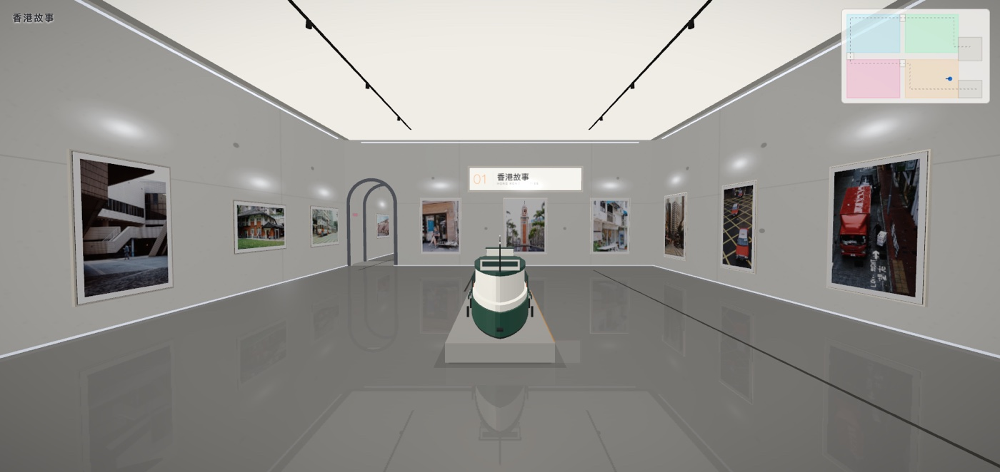
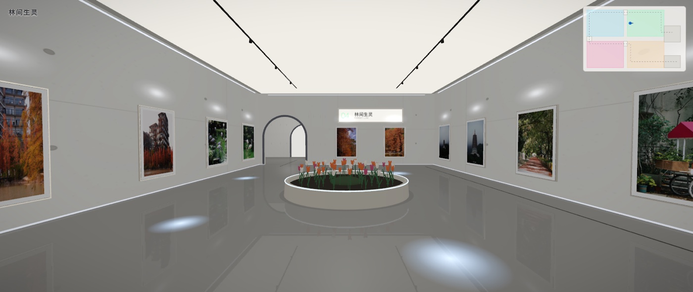
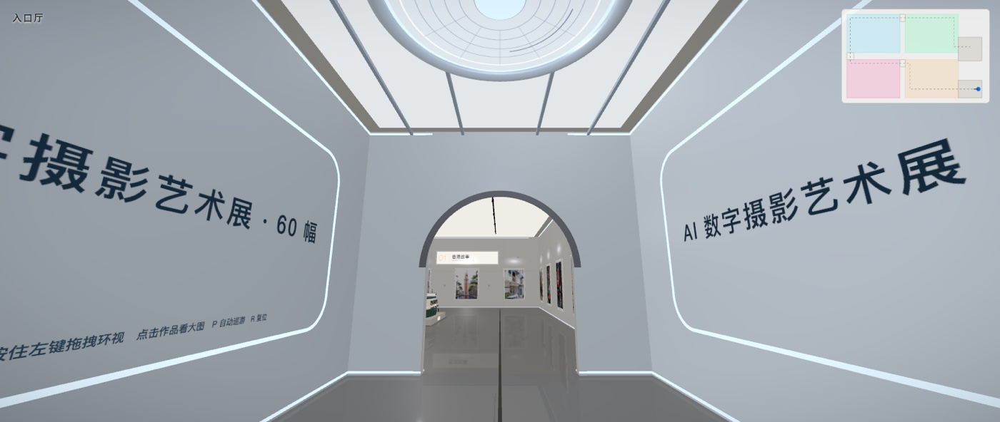

# 3D 摄影展布展系统

[English](README.en.md) · **简体中文**

[](https://github.com/Huangxxuan/gallery3d/actions/workflows/deploy.yml)
[](LICENSE)



**把拍下来的照片，变成一座可以走进去的 3D 摄影展览。**

浏览器打开就能逛展，漫游，

它在浏览器里实时渲染一栋真实尺度的展馆，观众用键盘交互，走进去，站在画前看，点一下进大图。

我把自己拍摄的作品60幅图片做的3D摄影展览，开箱就能体验；

你可以换成自己的作品图片和展题，一键部署你的展览。

**在线示例** — <https://huangxxuan.github.io/gallery3d/>（桌面端 Chrome / Safari / Edge，需 WebGL 与键盘）

---

## 一、它能搭什么

| 场景 | 怎么用 |
|---|---|
| **摄影个展 / 联展** | 按主题分厅，一厅一色温，作品自动上墙 |
| **艺术作品展** | 竖幅、横幅、方形混排，等比零裁剪，不拉伸不变形 |
| **文物 / 藏品展** | 固定机位 + 单件大图，适合看细节的展品 |
| **毕业展 / 团队作品集** | 一个仓库一套展，改图片即可换展 |
| **景区、门店、机构的线上展馆** | 静态站点，可挂 GitHub Pages / 任意 CDN |



---

## 二、三分钟看懂它怎么工作

```
你的图片文件夹
      │  scripts/prepare-assets.mjs（自动转三档尺寸 + 读取真实宽高）
      ▼
public/manifest.json  ← 展品清单：谁上墙、去哪个厅、什么朝向
      │  src/three/placements.ts（自动布展算法）
      ▼
墙面挂位  ← 定距 + 居中 + 端部留白，零裁剪
      │  React Three Fiber 实时渲染
      ▼
浏览器里的 3D 展厅
```

**布展是算出来的，不是摆出来的。** 你只提供「哪些图、去哪个厅」，剩下的自动完成：

- 相邻画心中心距恒为 **3.5 m**，不够一档的余量全部转为端部留白（留白才是策展感）
- 挂位距墙角 / 门洞边 ≥ **1.45 m**，画框永不压门洞
- 竖幅定高 2.1 m、横幅定宽 1.9 m，极端长宽比缩进 2.4 × 2.3 m 盒内，**永不裁剪、永不拉伸**
- 每厅默认精选 **15** 幅（`SELECT_CAP`），超出按题材均匀采样，不扎堆
- 大图机位按画高自适应（1.35–2.6 m），点击即飞到画心正前方



---

## 三、换成你自己的展

四种改动，从必做到可选。**只做第 1、2 步就能跑起来一场新展。**

### 第 1 步 ｜ 整理图片（必做）

按「分类文件夹」放图，脚本按文件夹映射展厅：

```
my-photos/
├── 城市/          # 分类名 = 后续配到某个厅
│   ├── a.jpg
│   └── b.jpg
└── 山海/
    └── c.jpg
```

支持 `jpg / jpeg / png / heic`（macOS 用系统 `sips` 转换，无需装任何第三方库）。

### 第 2 步 ｜ 改展厅映射（必做）

打开 [`scripts/prepare-assets.mjs`](scripts/prepare-assets.mjs)，改 `HALL_GROUPS`：

```js
const HALL_GROUPS = [
  { hall: 'H1', theme: '我的第一厅', cats: ['城市'] },
  { hall: 'H2', theme: '我的第二厅', cats: ['山海'] },
  { hall: 'H3', theme: '我的第三厅', cats: ['人像', '街头'] },  // 一个厅可吃多个文件夹
  { hall: 'H4', theme: '我的第四厅', cats: ['静物'] },
]
```

然后跑：

```bash
PHOTO_SRC=/path/to/my-photos node scripts/prepare-assets.mjs
```

（不设 `PHOTO_SRC` 时默认读 `~/Downloads/摄影作品`。）

产出三档 JPEG + 新的 `public/manifest.json`：主档长边 2048 / 远厅 1024 / 大图 4096。

### 第 3 步 ｜ 改厅名与主色（强烈建议）

打开 [`src/domain/themes.ts`](src/domain/themes.ts)，一个厅一行：

```ts
export const THEMES: Record<string, HallTheme> = {
  H1: { name: '你的厅名', en: 'YOUR HALL', accent: '#ffb054', glow: '#ffcf8a' },
  ...
}
```

`accent` 决定门楣展牌与 UI 色，`glow` 决定灯带辉光。改完厅名自动出现在墙上展牌、左上角与入口文字上。

### 第 4 步 ｜ 改展名（可选）

展名目前写在三处，全文替换即可：

| 文件 | 位置 |
|---|---|
| [`src/ui/HUD.tsx`](src/ui/HUD.tsx) | 启动页大标题与副标题 |
| [`src/three/GalleryWorld.tsx`](src/three/GalleryWorld.tsx) | 入口厅墙面发光字（两处） |
| [`index.html`](index.html) | 浏览器标题、`og:*` 分享卡 |

改完执行：

```bash
export PATH="$HOME/.local/node/bin:$PATH"
npm install
npm run dev        # http://localhost:5173/
```

### 改动对照表

| 想改什么 | 改哪里 | 需要重跑素材管线 |
|---|---|---|
| 换图片 | 换文件夹内容 + `HALL_GROUPS` | 是 |
| 换厅名 / 主色 | `src/domain/themes.ts` | 否 |
| 换展名 | 上表三处 | 否 |
| 换分享卡 | `docs/social-preview.jpg` + `public/social-preview.jpg`（1280×640） | 否 |
| 每厅上墙数量 | `SELECT_CAP`（`src/three/placements.ts`） | 否 |
| 厅数与建筑尺寸 | `src/domain/gallery.ts` 的 `SPACES` | 否 |

---

## 四、操作方式

进入后先见启动页，点「点击进入」按钮开始。

| 操作 | 键位 / 方式 |
|---|---|
| 前后左右行走 | `W` `A` `S` `D` 或方向键 |
| 快走 | 按住 `Shift` |
| 环视 | 按住鼠标左键拖拽；鼠标移动做微调 |
| 看大图 | 点击墙面作品 |
| 大图内翻页 | `←` `→`（或 `A` `D`） |
| 退出大图 | `Esc` / `Backspace` |
| 自动巡游 | `P` 切换 |
| 返回入口 | `R` |

调试参数（验收截图用）：`?cam=x,z,yaw,pitch` 直接定位机位，`?artview=n` 站到第 n 幅画前，`?focus=n` 直接进入第 n 幅大图。

---

## 五、技术栈

| 层 | 选型 |
|---|---|
| 渲染 | three.js 0.186 + React Three Fiber 9 + @react-three/drei |
| 框架 | React 19 + TypeScript 7，Vite 8 构建 |
| 状态 | zustand 5（模式机 / 焦点作品 / 当前展厅） |
| 测试 | Vitest 5（布展规则、分区、光斑几何、机位快照） |
| 部署 | GitHub Actions → GitHub Pages，push `main` 自动发布 |

全部为前端静态资源，无后端、无数据库、无外部字体 CDN（文字墙贴用 Canvas 运行时生成，离线可用）。

---

## 六、目录结构

```
src/
  domain/       展厅几何、挂位算法、主题配置（纯数据 + 纯函数，有单测）
  three/        场景渲染：墙体 / 拱门 / 天花 / 画作 / 纹理分级 / 碰撞 / 相机 / 文字墙贴
  state/        zustand 状态机
  ui/           HUD：启动页、操作提示、大图底栏
  spike/        光斑与机位实验场景（研究用，不在线上路径）
public/
  manifest.json 展品清单（id / 三档图路径 / 展厅 / 真实宽高）
  photos/       三级图：主档 · lo/ 远厅 · hd/ 大图
scripts/
  prepare-assets.mjs  素材管线：源图 → 三档 JPEG + manifest
  gen-floorplan.mjs   平面图生成
docs/          设计口径、ADR、交接文档、分享卡与截图
```

---

## 七、本地运行与部署

```bash
export PATH="$HOME/.local/node/bin:$PATH"   # 非交互 shell 需要，按你本机 Node 位置调整
npm install
npm run dev        # 开发服务器
npm test           # 单元测试
npm run build      # 产出 dist/
npm run preview    # 预览构建产物
```

推送 `main` 后，`.github/workflows/deploy.yml` 自动执行 `npm ci` → `npm run build` → 发布 Pages。

[`vite.config.ts`](vite.config.ts) 使用 `base: './'`：同一份 `dist/` 既能跑根路径（本地 / 离线包 / U 盘分发），也能跑 Pages 子路径 `/gallery3d/`。

---

## 八、已知边界

说清楚比藏着好，这些是设计取舍，不是待修 bug：

- **固定四厅**。建筑是一座 2×2 组团 + 蛇形动线的完整展馆，改厅数需要改 `SPACES` 几何（含门洞不变量测试），不是配置项。
- **每厅上限 15 幅**，四厅共 60。想挂更多，改 `SELECT_CAP` 并确认墙长容量够。
- **无后台 CMS**。展品清单是一个 JSON 文件，靠 git 管理版本。
- **需要 WebGL 与键盘**。移动端可以看，但漫游体验按桌面设计。
- **仓库体积会随作品线性增长**。示例 148 张图约 115 MB，GitHub Pages 上限 1 GB；作品量大时建议把 `public/photos/` 放对象存储或 CDN。

---

## 九、许可

### 代码：Apache License 2.0

全文见 [LICENSE](LICENSE)。

**你可以**

- 复制、修改、合并、发布、分发本项目代码
- 商用（Apache-2.0 不限制使用领域，这一点无法排除）
- 把衍生作品闭源分发

**你必须要**

- 保留 [LICENSE](LICENSE) 与源码中已有的版权、专利、商标、归属声明
- 在修改过的文件里注明「已修改」
- 分发时随附一份 Apache-2.0 副本
- 不得用作者名义或本项目商标为你的衍生作品背书

本项目按「现状」提供，不含任何明示或暗示担保；作者不对使用后果承担责任。

### 示例图片：不适用 Apache-2.0

`public/photos/**` 与 `docs/*.jpg` 是我的摄影作品与展厅截图，版权归作者所有。未经许可不得转载、商用或再分发。

要搭自己的展：fork 之后把图片换成你的，代码许可不变，作品版权归你。
